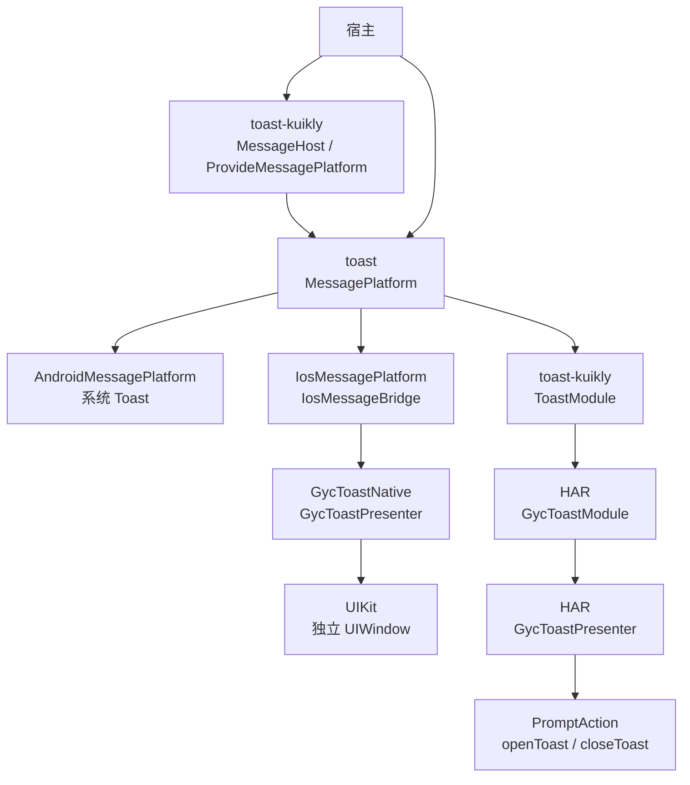
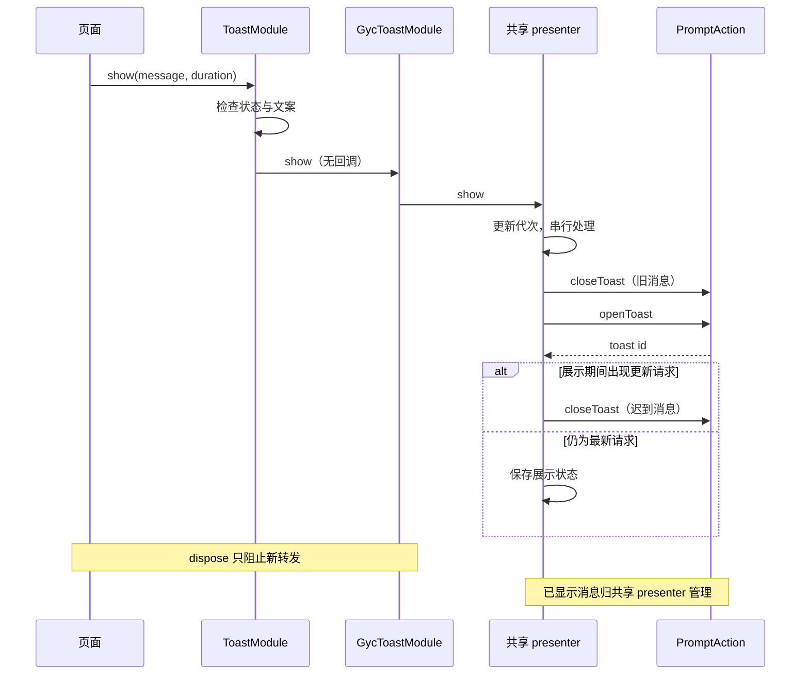
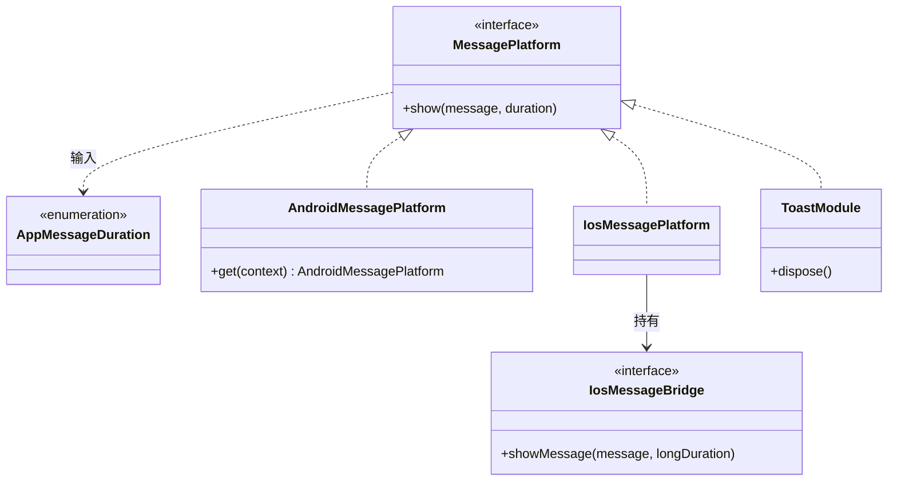

# GY CrossKit Toast

> 当前源码候选统一为 **1.0.0**：Maven（core/Kuikly）、iOS Pod 与 OHPM 使用同版；尚未发布，示例坐标须待发布后远程消费。本地验证使用显式源码/本地 HAR，Kuikly 基线为 2.29.1，真机与新版本远程消费另验。

当前源码为未发布的 Kuikly 2.29.1 配套候选；带发布标签的说明保留历史范围。新增 API 必须消费配套源码，不能用旧远程版本验证代替。

当前源码候选为 **Maven / iOS Pod / OHPM `1.0.0`，尚未发布**：移除 `toast-cmp`，仅维护 `toast` core 与 `toast-kuikly`。这是删除 CMP 公开坐标/API 的不兼容候选；旧 CMP 使用方应继续锁定已发布的 `0.1.x`，或迁移至 KuiklyCompose/native 入口，不能直接升级。

KuiklyCompose Android/iOS/OHOS 的 `MessageHost`、CompositionLocal、Compose compiler/runtime，以及共享 Overlay 状态、规格、定时替换和销毁合同保留。Android/iOS/OHOS 原生提示与 Module 也保留；文案和本地化由宿主提供，legacy 原生提示与 Overlay 的视觉/时长合同不同。详见[功能与平台差异](docs/功能与平台差异.md)。

`0.2.0-rc.1` 已发布；其公开制品检查与 Android 消费通过，Native job 在 Pod/Renderer 构建成功后因日志目录缺失退出，尚未执行 Maven Native 最终链接。本候选修复该 CI 顺序，旧 tag、归档和 checksum 保留。

原生 Git Pod 和 OHOS HAR 同步为 `1.0.0`，SPM 仍仅提供 presenter；本次未发布任一渠道。历史验证按原版本和日期保留，不证明当前候选通过公开消费或设备验收。

历史 0.1.3 的 Maven/Swift/Git Pod/Release HAR 消费与 OHPM 审核、Registry NOTFOUND 记录见[候选验收](verification/候选验收.md)。本次未重查 Registry，当前可安装性须单独核验；Release HAR 下载不代表 Registry 安装。

迁移与本轮渠道组合见 [RC 迁移说明](docs/RC迁移说明.md)。

## 平台与要求

| 平台 | 接入方式 | 系统要求 |
| --- | --- | --- |
| Android | Overlay用`toast-kuikly`；legacy用`toast` | API 24+ |
| iOS | Overlay用`toast-kuikly`；legacy用KMP bridge+`GycToastNative`或Swift/Pod | iOS 15+，Swift tools 5.9（原生包） |
| HarmonyOS | Overlay用`toast-kuikly`；legacy用Module+`toast-native` HAR或ArkTS | 当前 HAR 的 target/compatible SDK 均为 API 22；`openToast/closeToast` API 本身从 API 18 提供 |

KMP 使用 Kotlin `2.2.21-1.0.0`，Kuikly 使用 `2.29.1-2.0.21-ohos`。`toast-core/` 的 Gradle 模块名及公开 Maven artifact 为 `toast`。

## 架构与调用流程

`toast`定义MessagePlatform/OverlayState/Spec；`toast-kuikly`提供provider和MessageHost。下图保留legacy native路径：Android系统Toast、iOS桥与OHOS Module；共同Overlay在各自Host渲染，详见[功能与平台差异](docs/功能与平台差异.md)。文案与本地化由宿主提供。



HarmonyOS 展示通过共享 presenter 串行处理替换。Kuikly 的 `show` 是无结果回调的异步转发，调用返回不表示消息已经显示。



类图聚焦 KMP 契约及 bridge；KuiklyCompose 的 `ProvideMessagePlatform`、`rememberMessages` 是函数，不是额外 Manager 类。



源码：[MessagePlatform 与时长](toast-core/src/commonMain/kotlin/io/github/gycrosskit/toast/MessagePlatform.kt)、[Android 实现](toast-core/src/androidMain/kotlin/io/github/gycrosskit/toast/AndroidMessagePlatform.kt)、[iOS 实现与 bridge](toast-core/src/iosMain/kotlin/io/github/gycrosskit/toast/IosMessagePlatform.kt)、[KuiklyCompose 接线](toast-kuikly/src/commonMain/kotlin/io/github/gycrosskit/toast/kuikly/MessageComposition.kt)、[ToastModule](toast-kuikly/src/commonMain/kotlin/io/github/gycrosskit/toast/kuikly/ToastModule.kt)、[HAR Module](ohos/toast-native/src/main/ets/GycToastModule.ets)、[HAR Presenter](ohos/toast-native/src/main/ets/GycToastPresenter.ets)、[Swift Presenter](iosApp/Sources/GycToastNative/ToastPresenter.swift)。

## 安装

```kotlin
// settings.gradle.kts
dependencyResolutionManagement {
    repositories {
        maven("https://jitpack.io")
        maven("https://maven.eazytec-cloud.com/nexus/repository/maven-public/")
        google()
        mavenCentral()
    }
}
```

以下为尚未发布的候选坐标；远程构建、不可变 RC Release 和精确公开消费完成后方可安装：

```kotlin
commonMain.dependencies {
    implementation("com.github.gycrosskit.toast:toast-kuikly:1.0.0")
    // 仅使用 native core 时，改为依赖 toast:1.0.0。
}
```

iOS 在 Xcode 的 Package Dependencies 添加 `https://github.com/gycrosskit/toast.git`，选择精确版本 `0.1.5`，产品 `GycToastNative`。CocoaPods 可按 Git tag 安装，见接入指南。

HarmonyOS 原生包独立安装，候选正式可查询后执行；发布接受与 Registry 可安装分别核验：

```sh
ohpm install @gycrosskit/toast-native@1.0.0
```

旧稳定 `0.1.2` 有 Git tag、JitPack Maven 和 OHPM 包，未补写旧 Release。新候选 `1.0.0` 的 Swift Package 和 Git Pod 已分别完成独立真实原生消费：公开 API 编译及动态消费者/framework 最终链接均通过，产物为 arm64/x86_64 iOS Simulator Mach-O。SPM 锁定发布提交，Git Pod framework 版本为 1.0.0；这两个渠道单独验收，不以 KMP framework 链接代替。

## 最小使用

```kotlin
import androidx.compose.runtime.remember
import io.github.gycrosskit.toast.*
import io.github.gycrosskit.toast.kuikly.*

// 在 KuiklyCompose 页面根部记住一个 state；移除 Host 后不可复用该实例。
val messages = remember { MessageOverlayState() }
MessageHost(messages) {
    // 页面内可调用 rememberMessages().show("操作完成")。
}
```

```swift
import GycToastNative
// 稳定的根 UIViewController 创建后绑定：
GycToastPresenter.shared.bind(rootController: rootController)
GycToastPresenter.shared.show(message: "操作完成")
```

## 生命周期与边界

Android 的原生提示调用复用 `AndroidMessagePlatform.get(applicationContext)`，避免各自展示竞争。iOS 使用不可点击的独立 UIWindow，需要有效根控制器；KMP 宿主通过 `IosMessageBridge` 转发到原生 presenter。HarmonyOS 需要已创建主窗口的 UIAbilityContext 或注册 `GycToastModule`。

每个 Pager 注册组件 `ToastModule` 和原生 `GycToastModule`，业务只映射消息文案/时长；`pageWillDestroy` 调用 `ToastModule.dispose()`，原生 `onDestroy` 后拒绝消息。
不再把showMessage协议复制到应用的系统动作Module；已显示Toast仍由唯一presenter管理，不由旧Page销毁新Page消息。

无需额外系统权限。空白文案不展示；仅支持短/长时长和新消息替换，不提供消息队列或交互式提示。原生窗口显示、替换和多窗口行为仍需宿主设备验收。

## 文档与帮助

- [接入指南](docs/接入指南.md)：平台初始化、权限声明和生命周期。
- [开发与验证](docs/开发与验证.md)：源码构建、检查命令与验收范围。
- [完整源码审查](docs/完整源码审查.md)
- [版本与发行说明](https://github.com/gycrosskit/toast/releases)、[问题反馈](https://github.com/gycrosskit/toast/issues)。

Apache-2.0，见 [LICENSE](LICENSE)。

## 自动回归

当前源码回归使用[统一远程验证（Jenkins）](https://github.com/gycrosskit/.github/blob/main/docs/统一远程验证.md)，按已推送源码 ref/SHA 选择对应组件；平台命令与参数以受信 Jenkins recipe 为准。实际执行范围、测试数量、结果与耗时以绑定源码/CI SHA 的构建回执为准，轻量检查或跳过不算平台测试通过。

候选冻结与消费按[发布流程](https://github.com/gycrosskit/.github/blob/main/docs/发布流程.md)使用独立 Job：`component-ci/package` 绑定准确 SOURCE_SHA 生成冻结候选并验证私有消费，`component-ci/release` 绑定准确 Tag/候选执行发布及独立公开消费。核对冻结归档、精确 tag/commit、完整 publication 清单和公开文件，不使用 `mavenLocal`、本库源码或 staging 替换公开依赖；各阶段证据分别记录。

OHOS KLIB 编译不代表 HAR 构建、ohpm 上架或真机验收。当前没有已确认可用的 DevEco/Hvigor runner，这些检查尚未自动化，不能作为 CI 通过范围。

阶段、缓存、有限网络重试、失败记录与证据边界见[共用 CI 规则](https://github.com/gycrosskit/.github/blob/main/docs/持续集成门禁.md)；本库实际平台命令以 Jenkins 的固定版本 recipe 为准。源码通过、远程消费、HAR/ohpm 与设备验收分别记录。

当前 `verification` 默认消费远程两个现存 Maven 产品；未发布候选可显式传 `-PverifyLocalSource` 验证本仓库源码，该模式不代表公开消费。Android `verifyNoCmpUi` 拒绝第二套 JetBrains/AndroidX CMP UI，允许 KuiklyCompose/runtime。`0.1.x` 的三产品历史验收应检出对应 tag 使用原 consumer，不用当前候选合同重验旧归档。
